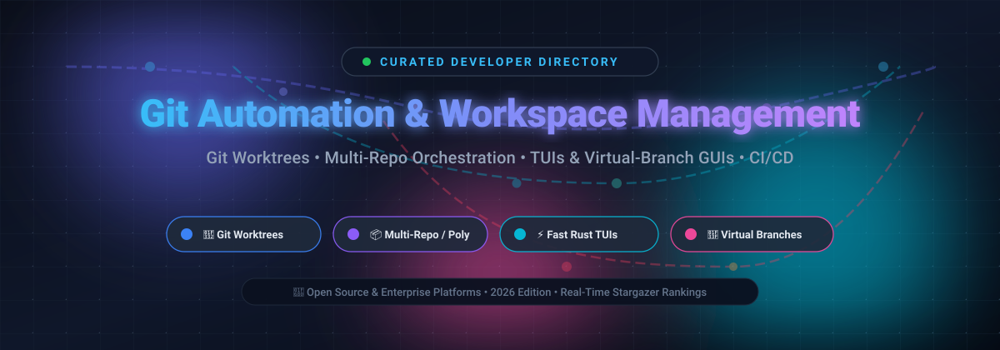

# ⚡ Awesome Git Automation & Workspace Management

<p align="center">
  
</p>

<p align="center">
  <a href="https://github.com/ishandutta2007/Awesome-Awesome-Awesome"></a>
  <a href="https://discord.gg/jc4xtF58Ve"></a>
  <a href="https://github.com/ishandutta2007/Awesome-Git-Automation-Workspace-Management/stargazers"></a>
  <a href="https://github.com/ishandutta2007/Awesome-Git-Automation-Workspace-Management/network/members"></a>
  <a href="https://github.com/ishandutta2007"></a>
</p>

---

## 🧭 Executive Summary & SEO Guide

Welcome to the definitive, curated index of **Git Automation, Git Worktree Management, Multi-Repo Workspace Orchestration, and Modern Git Clients (TUIs & GUIs)**. Whether managing polyrepo microservices, speeding up daily development with Rust-powered terminal user interfaces, or running parallel AI coding agents in isolated `git worktree` checkouts, this catalog indexes the market's leading commercial SaaS platforms and premier open-source tools.

### 🔍 Key Focus Areas & Search Terms
- 🌲 **Git Worktree Isolation & Automation**: Tools that spawn, switch, clean, and run parallel AI-agent tasks across simultaneous directory checkouts without stashing or branch switching (`worktrunk`, `git-worktree`).
- 📦 **Multi-Repository & Polyrepo Workspace Managers**: Coordinate atomic commits, batch status reports, synchronize branches, and run bulk shell scripts across dozens of microservices (`gita`, `mani`, `meta`, `git-subrepo`).
- ⚡ **High-Performance Terminal Git TUIs**: Ultra-fast terminal clients built in Rust and Go that deliver instantaneous commit staging, hunk discarding, interactive rebase, and diff browsing (`Lazygit`, `gitui`, `tig`, `delta`, `difftastic`).
- 🌿 **Virtual-Branch & Visual Desktop GUIs**: Cross-platform desktop interfaces with interactive commit graphs, stacked branch management, visual merge conflict resolvers, and virtual branches (`GitButler`, `GitHub Desktop`, `GitExtensions`, `Gittyup`).
- 🤖 **CI/CD Pipeline Automation & Git Hooks**: Run production workflows locally via Docker containers, automate commit message linting, and enforce zero-friction pre-commit hooks (`act`, `Lefthook`, `pre-commit`, `commitlint`).

---

## 📑 Table of Contents

- [📊 Sector Overview & Market Dynamics](#-sector-overview--market-dynamics)
- [☁️ SaaS/Hosted & Commercial Platforms](#️-saashosted--commercial-platforms)
- [💻 Open-Source GitHub Projects](#-open-source-github-projects)
- [📈 Star History](#-star-history)
- [🛠️ How to Contribute](#️-how-to-contribute)
- [💖 Support & Sponsorship](#-support--sponsorship)
- [⚠️ Disclaimer](#️-disclaimer)

---

## 📊 Sector Overview & Market Dynamics

The global Developer Productivity, Source Control & Git Workspace Management Software market is valued at approximately **$14.5B–$18.2B+ in 2026**, expanding at a ~18%–23% CAGR propelled by parallel AI coding-agent workflows (`git worktree` isolation), polyrepo microservice orchestration, and local-first CI/CD automation. 

While cloud Git/CI hosting platforms exhibit **strong winner-take-most consolidation** around Microsoft GitHub, GitLab, and Atlassian Bitbucket, the **desktop Git GUI and local workspace management client layer** remains **vibrantly fragmented**, witnessing rapid market disruption from **blazing-fast Rust/Go terminal TUIs and next-generation open-source workspace managers** (`max-sixty/worktrunk`, `Lazygit`, `gitui`, `GitButler`, `gita`).

---

## ☁️ SaaS/Hosted & Commercial Platforms

*Sorted descending by estimated company valuation / annual revenue scale.*

| 🏢 Platform | 📝 Description | 💼 Company Scale (Valuation / Revenue) | 🏷️ Starting Paid Tier | 🎁 Free Tier / Trial Limit |
| :--- | :--- | :--- | :--- | :--- |
| **[GitHub Actions (Microsoft)](https://github.com)** | ⚡ Event-driven CI/CD and Git repository workflow automation engine built natively into GitHub and GitHub Workspaces/Codespaces. | **Part of Microsoft / GitHub** (~$2B+ GitHub ARR; ~$3T+ Microsoft market cap) | **$4 / user / month** for GitHub Team (3,000 CI/CD minutes/mo + 2 GB Packages storage) | **Forever Free Plan** (**Unlimited CI/CD minutes for public repositories** + **2,000 free minutes/month** for private repos) |
| **[Bitbucket Pipelines (Atlassian)](https://bitbucket.org)** | 🔄 Cloud-native CI/CD automation and repository workspace management integrated directly inside Bitbucket Cloud and Jira. | **Part of Atlassian Corp.** (~$4.5B+ annual revenue; ~$55B+ public market cap) | **$3.30 / user / month** for Standard plan (2,500 build minutes/mo + 5 GB LFS storage) | **Forever Free Plan** (Up to **5 users** and **50 build minutes/month** free indefinitely for small teams) |
| **[Sourcetree (Atlassian)](https://sourcetreeapp.com)** | 🖥️ Free visual desktop Git and Mercurial GUI client for Windows and macOS featuring interactive rebase, commit graphs, and Bitbucket/GitHub integration. | **Part of Atlassian Corp.** (~$4.5B+ annual revenue; ~$55B+ public market cap) | **$0 / Free Proprietary Software** (Requires free Atlassian account registration during setup) | **100% Free Forever** (Unlimited private and commercial repositories on Windows and macOS with zero seat fees) |
| **[GitLab CI (GitLab Inc.)](https://gitlab.com)** | 🦊 Unified DevSecOps platform combining Git source control, workspace environments, Auto DevOps CI/CD pipelines, and merge-request automation. | **~$750M+ Annual Revenue** (~$8B–$10B+ public market cap on NASDAQ) | **$29 / user / month** billed annually for GitLab Premium (10,000 compute minutes/mo) | **Forever Free Tier** (Up to **5 users**, **400 compute minutes/month** on SaaS; unlimited users on self-hosted GitLab CE) |
| **[CircleCI](https://circleci.com)** | ⭕ High-speed cloud CI/CD platform featuring Docker layer caching, workspace artifact persistence, parallelism, and reusable Orbs. | **~$1.7B Peak Valuation** ($315M+ VC funding; ~$100M+ est. ARR) | **$15 / month** for Performance plan (includes 30,000 credits/mo + 5 active users) | **Forever Free Plan** (**6,000 free build minutes/month** (30,000 credits) with up to **30x concurrency** and Linux/Docker runners) |
| **[Travis CI (Idera)](https://travis-ci.com)** | 🏗️ Cloud-hosted continuous integration and build-matrix service supporting 30+ languages across Linux, macOS, and Windows environments. | **Part of Idera, Inc.** (~$500M+ Idera software group revenue) | **$64 / month** billed annually ($69/mo monthly for Bootstrap plan, 2 concurrent jobs) | **Free Trial Credits & Open-Source Program** (**10,000 free trial credits** upon signup + free credits for approved OSS projects) |
| **[GitKraken Client](https://gitkraken.com)** | 🐙 Cross-platform desktop Git GUI, CLI, and multi-repo Workspaces suite with visual commit graphs, merge conflict editor, and Jira/GitHub integration. | **~$50M–$100M Est. Valuation** (~$20M+ est. ARR; >30M developers; acquired GitLens) | **$4.95 / user / month** billed annually (Pro tier for private repos & cloud Workspaces) | **Forever Free Plan** (100% free for **local and public cloud repositories**; paid plan required for private cloud repositories) |
| **[Tower (fournova)](https://git-tower.com)** | 🗼 Native macOS and Windows desktop Git client prized for drag-and-drop interactive rebase, stacked PRs, worktree support, and undo history. | **~$10M–$25M Est. Scale** (Profitable independent German Git software vendor) | **$69 / user / year** (Basic plan) or **$99 / user / year** (Pro plan with stacked PRs & worktrees) | **30-Day Full-Access Free Trial** (Includes full Pro features for 30 days; free licenses for students, teachers, and open-source maintainers) |
| **[Fork (Dan Pristupov)](https://git-fork.com)** | 🍴 Fast, native macOS and Windows Git GUI client offering interactive rebase, visual diff/merge resolver, reflog viewer, and submodule management. | **Bootstrapped Indie Software** (Profitable independent two-person developer team) | **$59.99 one-time** perpetual license (valid across macOS and Windows with 3 years of updates) | **Unlimited Evaluation Trial** (Free download with no time cutoff and periodic purchase reminders; one-time license removes prompt) |
| **[SmartGit (syntevo)](https://syntevo.com)** | 🧠 Cross-platform desktop Git client (Windows, macOS, Linux) featuring log-graph workflows, built-in SSH/merge tools, and Git-Flow/SVN bridges. | **Bootstrapped German Software Vendor** (Profitable 20+ year developer-tools company) | **$6.90 / month** billed annually ($82.80/yr) or **$189 one-time** perpetual commercial license | **Forever Free Non-Commercial License** (100% free for open-source developers, students, teachers, and hobbyists + 30-day commercial trial) |

---

## 💻 Open-Source GitHub Projects

*Sorted descending by real-time GitHub stargazer count.*

| 📦 Repository & Stars | 🏷️ Category | 📜 License | 📝 Description |
| :--- | :--- | :--- | :--- |
| **[jesseduffield/lazygit](https://github.com/jesseduffield/lazygit)**<br>[](https://github.com/jesseduffield/lazygit/stargazers) | ⚡ Terminal & TUI Git Client | `GPL-3.0 / MIT` | 🗂️ Simple and elegant terminal UI for git commands written in Go, providing fast interactive staging, commit graphing, and rebasing. |
| **[nektos/act](https://github.com/nektos/act)**<br>[](https://github.com/nektos/act/stargazers) | 🐳 Local CI/CD Runner | `MIT` | 🚀 Run your GitHub Actions locally inside Docker containers for rapid testing, instant pipeline debugging, and zero cloud build costs. |
| **[cli/cli](https://github.com/cli/cli)**<br>[](https://github.com/cli/cli/stargazers) | 💻 Official GitHub CLI | `MIT` | 🐙 GitHub’s official command line tool bringing pull requests, issues, GitHub Actions, releases, and repo management into the terminal. |
| **[dandavison/delta](https://github.com/dandavison/delta)**<br>[](https://github.com/dandavison/delta/stargazers) | 🎨 Syntax Diff & Pager | `MIT` | 🔍 A syntax-highlighting pager and diff viewer for git, diff, and grep outputs with inline side-by-side visualization and themes. |
| **[Wilfred/difftastic](https://github.com/Wilfred/difftastic)**<br>[](https://github.com/Wilfred/difftastic/stargazers) | 🌳 Structural AST Diff | `MIT` | 🧩 A structural, syntax-aware diff tool that compares code based on AST grammar semantics rather than raw whitespace or line changes. |
| **[extrawurst/gitui](https://github.com/extrawurst/gitui)**<br>[](https://github.com/extrawurst/gitui/stargazers) | 🦀 Rust Terminal UI | `MIT` | 💥 Blazing-fast terminal UI for Git written in Rust with vim keybindings, submodule support, and minimal CPU/memory footprint. |
| **[desktop/desktop](https://github.com/desktop/desktop)**<br>[](https://github.com/desktop/desktop/stargazers) | 🖥️ Desktop GUI Client | `MIT` | 🌐 GitHub Desktop open-source visual Git client for smooth cross-platform repository collaboration on macOS and Windows. |
| **[gitbutlerapp/gitbutler](https://github.com/gitbutlerapp/gitbutler)**<br>[](https://github.com/gitbutlerapp/gitbutler/stargazers) | 🌿 Virtual Branches & Workspace | `FSL-1.1-Apache-2.0` | 🔀 Next-generation desktop Git client supporting simultaneous virtual branches, trunk-based workflows, and commit management. |
| **[conventional-changelog/commitlint](https://github.com/conventional-changelog/commitlint)**<br>[](https://github.com/conventional-changelog/commitlint/stargazers) | 📏 Commit Message Linter | `MIT` | 📓 Lint and enforce conventional commit conventions across multi-developer teams and CI build pipelines. |
| **[so-fancy/diff-so-fancy](https://github.com/so-fancy/diff-so-fancy)**<br>[](https://github.com/so-fancy/diff-so-fancy/stargazers) | ✨ Diff Enhancement | `MIT` | 👓 Good-looking diffs for human eyes, highlighting changed words and stripping tedious diff header noise. |
| **[commitizen/cz-cli](https://github.com/commitizen/cz-cli)**<br>[](https://github.com/commitizen/cz-cli/stargazers) | ✍️ Commit Formatting Tool | `MIT` | 🤖 Interactive CLI prompt utility that formats commit messages according to standardized conventional commit guidelines. |
| **[pre-commit/pre-commit](https://github.com/pre-commit/pre-commit)**<br>[](https://github.com/pre-commit/pre-commit/stargazers) | 🪝 Git Hook Framework | `MIT` | 🛡️ Multi-language package manager for Git pre-commit hooks, automated formatters, and static security linters. |
| **[jonas/tig](https://github.com/jonas/tig)**<br>[](https://github.com/jonas/tig/stargazers) | 📟 Ncurses Git TUI | `GPL-2.0` | 📜 Classic text-mode interface for Git acting as a repository browser, commit log explorer, and staging pager. |
| **[max-sixty/worktrunk](https://github.com/max-sixty/worktrunk)**<br>[](https://github.com/max-sixty/worktrunk/stargazers) | 🌲 AI Worktree Orchestrator | `Apache-2.0` | 🤖 Git worktree management CLI purpose-built for orchestrating parallel AI coding agents and isolated branch testing. |
| **[FredrikNoren/ungit](https://github.com/FredrikNoren/ungit)**<br>[](https://github.com/FredrikNoren/ungit/stargazers) | 🕸️ Web-Based Git Visualizer | `MIT` | 🌐 Interactive node-based web GUI bringing clean visual node graphs and intuitive commit branch management to the browser. |
| **[evilmartians/lefthook](https://github.com/evilmartians/lefthook)**<br>[](https://github.com/evilmartians/lefthook/stargazers) | 🚀 Fast Git Hooks Manager | `MIT` | ⚡ Fast, polyglot Git hooks manager written in Go capable of parallel hook execution and zero-dependency installs. |
| **[gitextensions/gitextensions](https://github.com/gitextensions/gitextensions)**<br>[](https://github.com/gitextensions/gitextensions/stargazers) | 🪟 Full-Featured Git GUI | `GPL-3.0` | 🛠️ Rich standalone desktop graphical user interface tool for Windows, macOS, and Linux with comprehensive repository tooling. |
| **[magit/magit](https://github.com/magit/magit)**<br>[](https://github.com/magit/magit/stargazers) | 🧙 Emacs Git Porcelain | `GPL-3.0` | 🔮 Legendary keyboard-driven Git porcelain inside Emacs offering complete, seamless control of Git workflows. |
| **[ingydotnet/git-subrepo](https://github.com/ingydotnet/git-subrepo)**<br>[](https://github.com/ingydotnet/git-subrepo/stargazers) | 📁 Submodule Alternative | `MIT` | 🔗 Git Submodule alternative that clones external repositories into subdirectories as clean native git commits. |
| **[Murmele/Gittyup](https://github.com/Murmele/Gittyup)**<br>[](https://github.com/Murmele/Gittyup/stargazers) | 🖼️ C++ Qt Git Client | `GPL-2.0` | 🔎 Fast graphical Git client designed to understand history, visual diffs, and interactive staging without bloat. |
| **[mateodelnorte/meta](https://github.com/mateodelnorte/meta)**<br>[](https://github.com/mateodelnorte/meta/stargazers) | 🗃️ Multi-Repo Workspace Tool | `MIT` | 🗂️ Tool for managing multi-repo architectures and monorepo-like meta workspaces across complex distributed services. |
| **[nosarthur/gita](https://github.com/nosarthur/gita)**<br>[](https://github.com/nosarthur/gita/stargazers) | 🐍 Multi-Repo Management CLI | `MIT` | 🔀 Lightweight Python CLI to manage multiple git repositories simultaneously with batched status and branch views. |
| **[alajmo/mani](https://github.com/alajmo/mani)**<br>[](https://github.com/alajmo/mani/stargazers) | ⚙️ Repository Orchestrator | `MIT` | 🤖 CLI tool and workspace orchestrator to execute commands and scripts across multiple repositories simultaneously. |

---

## 📈 Star History

[](https://www.star-history.com/#ishandutta2007/Awesome-Git-Automation-Workspace-Management&type=date&legend=top-left)

---

## 🛠️ How to Contribute

Contributions are warmly welcomed! Please follow these simple guidelines:
1. 🍴 **Fork** the repository.
2. 🌿 Create a new feature or entry branch (`git checkout -b add-tool-name`).
3. 📝 Add factual, objective descriptions with direct links to official documentation or source code.
4. ⭐ For open-source projects, ensure the badge points to the stargazers page:
   ```markdown
   [](https://github.com/owner/repo/stargazers)
   ```
5. 🚀 Submit a Pull Request with a concise summary of the addition!

---

## 💖 Support & Sponsorship

If you found this curated list helpful in orchestrating your Git workflows, managing polyrepo workspaces, or discovering powerful new tools:

- ⭐ **Star** this repository to help other developers find it.
- 🍴 **Fork** and share it with your engineering team or community.
- ☕ **Buy me a coffee / sponsor the project**: Support continued maintenance and curated updates via the [GitHub Sponsors Dashboard](https://github.com/sponsors/ishandutta2007).

Your support is deeply appreciated! 🙌

---

## ⚠️ Disclaimer

All product names, logos, and brands are property of their respective owners. Company names, platforms, and software mentioned are for identification and informational purposes only. Evaluation rankings and pricing tiers are subject to change by their respective providers.
